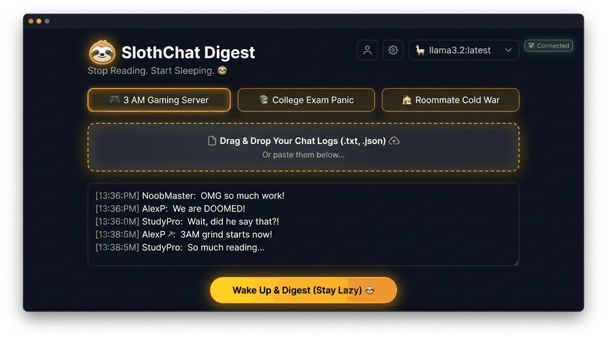
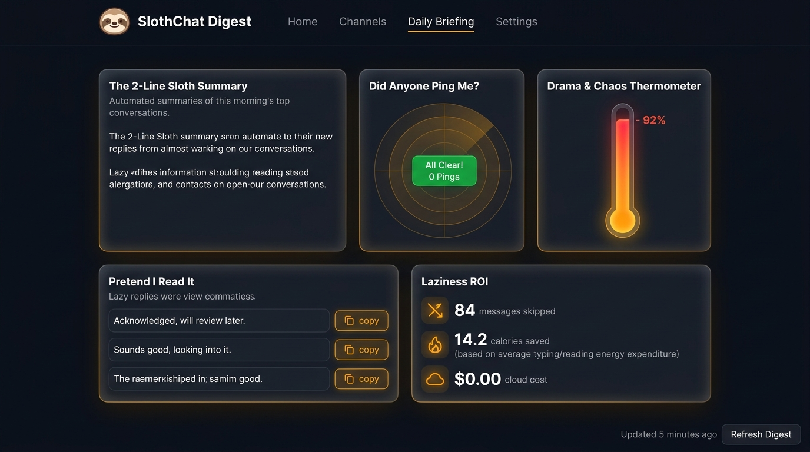
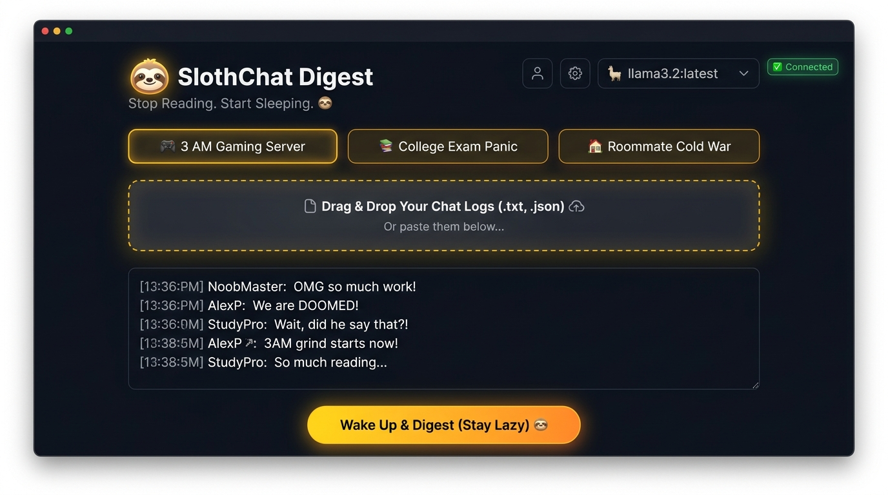
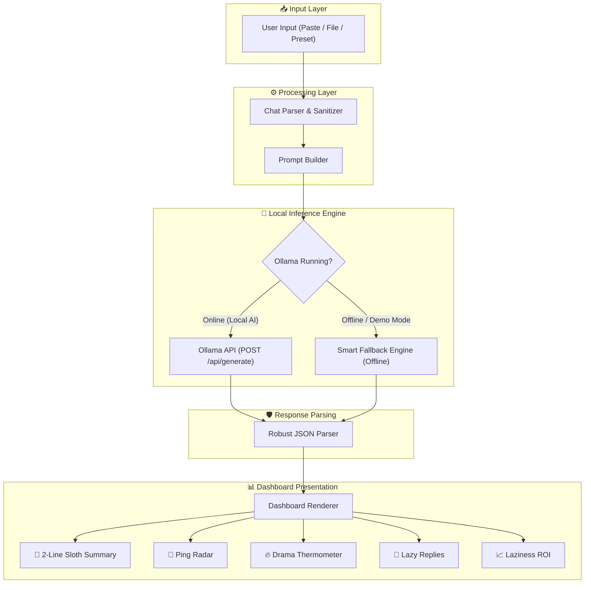
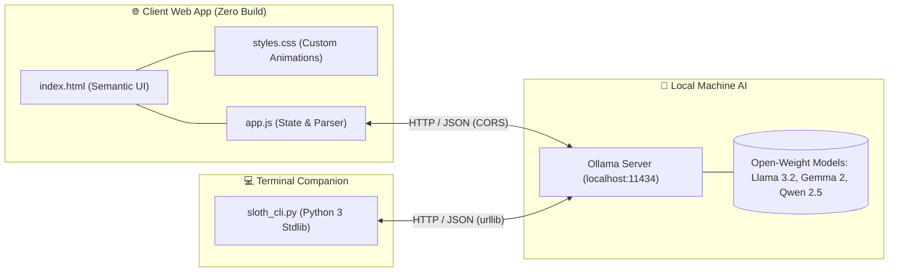

<div align="center">
  <h1>🦥 SlothChat Digest: TL;DR My Friends</h1>
  <p><em>Stop reading 400 chaotic overnight messages. Let your local Sloth AI do it.</em></p>
  <p>
    
    
    
    
  </p>

  <br />
  
  <p><em>Watch the lazy morning briefing in action: load presets, simulate local AI, view drama radar, and copy replies in seconds.</em></p>
</div>

---

## 🎯 What Is This?

SlothChat Digest is a **100% local, privacy-first group chat summarizer** powered by open-weight models via [Ollama](https://ollama.ai). Instead of reading 400 chaotic overnight messages from your Discord server or WhatsApp group, you drop the chat log and get a lazy morning briefing in seconds.

**Built for the Hacktoberfest Open-Source AI Challenge** — Theme: *"Slow and Steady"* — rewarding laziness with local AI.

### ✨ Key Features
- 🦥 **2-Line Sloth Summary** — The entire night's chaos in two punchy sentences
- 🔔 **Ping Radar** — Know if anyone actually needs you (spoiler: probably not)
- 🔥 **Drama Thermometer** — 0% to 100% Unhinged scale
- 💬 **Lazy Reply Generator** — One-click copy-paste replies to fake participation
- 📊 **Laziness ROI** — Gamified stats: messages skipped, calories saved, $0 cost
- 🔒 **100% Private** — All processing happens on YOUR machine, $0 cloud API cost
- 🎮 **Pre-loaded Demo Chats** — 3 hilarious chaotic chat logs included
- 🤖 **Smart Fallback** — Works without Ollama for instant demos

---

## 📸 Screenshots & UI Walkthrough

### 1. 🦥 The "Sloth Morning Briefing" Dashboard
Get the full picture at a glance without reading hundreds of chaotic messages:


### 2. 🎮 Input Zone & Chaotic 3 AM Presets
Choose from 3 hilarious pre-loaded scenarios or drop in your own chat export:


---

## 🏗️ Architecture

SlothChat Digest is architected to run completely client-side and offline, routing inference either to your local Ollama daemon or a smart deterministic fallback engine.



### Component Relationships



---

## 🚀 Quick Start

### Prerequisites
- A modern web browser (Chrome, Firefox, Edge, Safari)
- [Ollama](https://ollama.ai) installed (optional — app works in demo mode without it)

### Option 1: Just Open It (Demo Mode)
1. Clone or download this repository
2. Open `index.html` in your browser
3. Click any preset chat → Click **"Wake Up & Digest"** → Enjoy!

### Option 2: With Local AI (Full Power)
1. Install Ollama from [ollama.ai](https://ollama.ai)
2. Pull a model:
   ```bash
   ollama pull llama3.2:latest
   # Or for lighter models:
   ollama pull gemma2:2b
   ollama pull qwen2.5:3b
   ```
3. Start Ollama with CORS enabled:
   ```bash
   OLLAMA_ORIGINS="*" ollama serve
   ```
   On Windows (PowerShell):
   ```powershell
   $env:OLLAMA_ORIGINS="*"; ollama serve
   ```
4. Open `index.html` — the connection badge should show **"Connected"** ✅
5. Select your model, paste a chat or use a preset, and digest!

### Option 3: CLI Mode (Terminal Sloths)
Prefer the command line? Use the zero-dependency Python CLI companion:

```bash
# Basic run with local Ollama
python sloth_cli.py chat_export.txt

# Specify model and target username for ping detection
python sloth_cli.py chat_export.txt --model llama3.2:latest --target "@YourName"

# Run in instant offline demo mode (no Ollama required)
python sloth_cli.py chat_export.txt --demo
```

---

## 🛠️ Tech Stack

| Layer | Technology | Why |
|-------|-----------|-----|
| **UI Framework** | Tailwind CSS (CDN) | Zero build step, utility-first styling |
| **Icons** | Lucide Icons | Clean, consistent, tree-shakeable SVG icons |
| **Fonts** | Space Grotesk + JetBrains Mono | Modern geometric sans + readable monospace for code & logs |
| **AI Backend** | Ollama (Local) | Free, private, open-source LLM runtime |
| **Supported Models** | Llama 3.2, Gemma 2, Qwen 2.5, Mistral, Phi-3 | Open-weight, runs on everyday consumer hardware |
| **CLI Companion** | Python 3 (Standard Library only) | Zero pip dependencies, runs anywhere Python is installed |

---

## 🌍 Why Open Source Matters

### The Privacy Problem
Every cloud-based AI summarizer requires sending your personal group chats to remote servers. That means:
- Your inside jokes, personal drama, and private conversations get uploaded
- You're paying per token for something that should be free
- You have zero control over data retention or model retraining on your private data

### The SlothChat Solution
- **Open-weight models** (Llama, Gemma, Qwen, Mistral) run entirely on your machine
- **Ollama** makes local inference as easy as `ollama pull && ollama serve`
- **Zero network requests** to any cloud AI service
- **Your data never leaves your device**
- **Total cost: $0.00** — forever

### Open Source = Laziness Done Right
The "Slow and Steady" theme isn't just about being lazy — it's about building sustainable, privacy-respecting tools that anyone can run, modify, and improve. Open source means:
- 🔍 **Auditable** — Read every line of code, no black boxes
- 🔧 **Customizable** — Add your own presets, change the prompt, tweak the UI
- 🤝 **Community-driven** — PRs welcome for new features and chat formats
- ♻️ **Sustainable** — No API keys to expire, no subscriptions to cancel

---

## 📁 Project Structure

```
slothchat-digest/
├── index.html              # Main web UI (Tailwind CSS, responsive layout)
├── styles.css              # Custom styles, animations, & glassmorphism theme
├── app.js                  # Core application logic, Ollama integration & parser
├── sloth_cli.py            # CLI companion for terminal users (stdlib only)
├── sample_chat.txt         # Pre-bundled chaotic chat export for instant CLI testing
├── assets/                 # Screenshots & visual media
│   ├── demo.gif            # Animated live walkthrough demo
│   ├── screenshot_dashboard.jpg  # Sloth Morning Briefing UI preview
│   └── screenshot_input.jpg      # Input zone & preset selector UI preview
└── README.md               # Documentation & architecture guide 🦥
```

---

## 🤝 Contributing

Contributions are welcome! Some great ideas to contribute:
- Add support for Telegram, Signal, or Slack chat export formats
- Add more hilarious preset chat scenarios (e.g. D&D session chaos, family group chats)
- Implement multi-language group chat support
- Add local digest history (localStorage / SQLite)
- Package a browser extension version

---

## 📄 License

MIT License — Do whatever you want. Stay lazy. 🦥

---

<div align="center">
  <p>Built with 🦥 laziness & open-source AI</p>
  <p><strong>Hacktoberfest 2026 • "Slow and Steady" Theme</strong></p>
  <p><em>Because reading group chats is overrated.</em></p>
</div>
